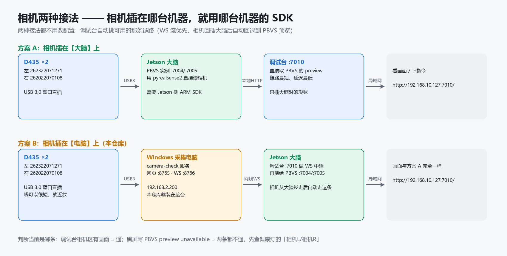

# OuO-s/camera — 双路 USB 相机采集端（电脑侧）

把两台 **Intel RealSense D435**（左臂腕 `262322071271` / 右臂腕 `262022070108`）插在
**Windows 采集电脑**上，由本仓库的 `camera-check` 服务按序列号读彩色流 + 深度，
再经 **MJPEG / WebSocket** 转发给机器人主控（Jetson）上的 PBVS 视觉伺服。

> **为什么单独一个仓库**：相机有两种接法 —— 插在**大脑**上，或插在**电脑**上。
> 代码和部署方式完全不同，所以按机器拆成两个仓库维护。

| 仓库 | 跑在哪台机器 | 装什么 |
|---|---|---|
| **OuO-s/camera**（本仓库） | Windows 采集电脑 `192.168.2.200` | 相机服务 `camera-check`、RealSense 驱动、Jetson 侧接收端 |
| [OuO-s/robot](https://github.com/OuO-s/robot) | 机器人主控 Jetson `/home/tianlian` | 调试台 `:7010`、标注工具、检测旁路 `:7020` |

## 相机两种接法



| | 方案 A：相机插**大脑** | 方案 B：相机插**电脑**（本仓库） |
|---|---|---|
| 谁读相机 | Jetson 上的 PBVS 实例（`pyrealsense2` 本地直读） | Windows 上的 `camera-check`（`pyrealsense2` 本地直读） |
| 画面怎么到网页 | PBVS 自己出 `preview`，调试台直接取 `:7004/:7005` | 经 WebSocket 转发到 Jetson，调试台走 WS 中继 |
| 需要装什么 | Jetson 侧 RealSense SDK（ARM 版） | 电脑侧 RealSense SDK（Windows 版，见 `driver/`） |
| 好处 | 链路最短、延迟最低 | 相机离工位近、线短；推理机不用挪；USB 带宽不吃 Jetson |
| 掉线表现 | 调试台相机区黑屏 `PBVS preview unavailable` | 同上；健康灯 `相机L/相机R` 变红 |

调试台会自动选择可用的那条链路（WS 流优先，回插 Jetson 后自动回退到 PBVS preview），
**不需要改配置**。

## 目录

```
camera-check/            电脑(Windows)上实际部署的服务 —— 与现场路径一一对应, 别改相对位置
  realsense_server.py    主服务: 网页 :8765 + MJPEG + WebSocket :8766 + 深度查询
  index.html app.js styles.css   检查台网页(枚举相机/选序列号/看两路画面)
  requirements.txt       电脑侧 Python 依赖
camera-brain/            拷到 Jetson 的接收端(可选, 用于验证链路/接检测代码)
  jetson_ws_receiver.py  收流 + 深度查询 + 可挂 process_frame() 做推理
  requirements-jetson.txt
driver/                  RealSense 驱动(可入库的部分)
  README_先看我.md        驱动包原说明: 安装步骤、注意项
  RealSense.Viewer.exe    免安装单文件 Viewer(18.9MB), 装 SDK 前先双击它验机
  test_d435.py            连通性自检: 枚举相机 + 拍彩图 + 深度统计
  -- 官方完整 SDK 安装包(116MB, 超 GitHub 单文件 100MB 限制)在 Releases 里下载 --
     直链: https://github.com/OuO-s/camera/releases/download/v1.0-driver/D435_SDK_v2.58.4_Windows.zip
docs/
  部署指南.md             在一台新电脑上从零部署(装驱动 → 建 venv → 起服务 → 验链路)
  上传与发布说明.md       本仓库怎么建/怎么推、驱动怎么发 Release
tools/
  publish_release.ps1     一键把驱动安装包发到 GitHub Release(不进 git)
```

## 快速开始（新电脑）

```powershell
# 1) 装驱动: 先双击 driver\RealSense.Viewer.exe 验机;
#    正式使用请装 Releases 里的 RealSense.SDK-WIN10-2.58.4.10922.exe, 装完重启。
# 2) 建环境
py -3.12 -m venv .venv
.\.venv\Scripts\python.exe -m pip install -r camera-check\requirements.txt
# 3) 起服务
.\.venv\Scripts\python.exe camera-check\realsense_server.py
# 4) 打开检查台
start http://localhost:8765
```

服务监听所有网卡，接线正确时：

| 接口 | 地址 |
|---|---|
| 检查台网页 | `http://192.168.2.200:8765` |
| 左相机 MJPEG | `http://192.168.2.200:8765/stream/262322071271` |
| 右相机 MJPEG | `http://192.168.2.200:8765/stream/262022070108` |
| 左相机 WebSocket | `ws://192.168.2.200:8766/camera/262322071271` |
| 右相机 WebSocket | `ws://192.168.2.200:8766/camera/262022070108` |

详细步骤、防火墙放行、Jetson 侧验证命令见 **[docs/部署指南.md](docs/部署指南.md)**。

## 从现场机器同步回本仓库

```powershell
robocopy "D:\AI\project\Company\robot\camera-check" .\camera-check /E /XD __pycache__ /NFL /NDL /NJH /NJS
git add -A; git commit -m "同步现场相机服务 $(Get-Date -Format yyyy-MM-dd)"; git push
```

## 注意

- 相机必须插 **USB 3.0 蓝色口**，线也要是 USB3 的；USB2 下深度会严重降级。
- `pyrealsense2` 不允许多进程共享：跑本服务前关掉 **RealSense Viewer** 和其它占相机的程序。
- Jetson 侧 SDK 是 ARM 版，和电脑侧互不相干：**相机插在哪台机器，就用哪台机器的 SDK**。
- 序列号印在相机底部标签上，两台可以同时插、按序列号分别取流。
